### 🎮 Character Sheet

|  |  |
| :-- | :-- |
| 🧝‍♀️ **Player** | Michella Arlene |
| ⚔️ **Class** | Forward Deployed Engineer |
| 🏰 **Guild** | [WidaTech](https://michella-arlene.github.io/#experience) — since Jul 2026 |
| 🎓 **Academy** | Computer Science @ BINUS University · GPA 3.88 · Dean's List 2025 |
| 🗺️ **Home base** | Jakarta, Indonesia 🇮🇩 |
| ✨ **Special move** | I don't just sit and code — I meet the client, map the problem, build the app, and ship it to production |

### ⚔️ Current Quests

- 🚚 **Freight ops & alert system** — live container tracking with deadline alerts for a freight forwarder
- 🛒 **Retail POS + AI sales assistant** — serial-tracked POS with a WhatsApp & Instagram AI helper
- 🌏 **Cross-border e-commerce + CMS** — Go API, React admin and a Flutter app in three languages
- 📄 **Supplier invoice portal** & 🤖 **AI shipping-document automation**

### 🏆 Achievements Unlocked

| | Achievement | Where |
| :-: | :-- | :-- |
| 🥈 | **1st Runner-Up, Industrial Category** — 267 teams, 12 economies | APICTA 2025 |
| 🔬 | **Top 10 Finalist, Research Category** | APICTA 2025 |
| 📜 | **Dean's List** — Computer Science | BINUS 2025 |
| 💖 | **Favourite Winner & Top 10 Finalist** | Arkavidia 9.0 Hackathon, ITB |
| 🌱 | **2nd Best Finalist** | Samsung Solve for Tomorrow 2025 |
| ✍️ | **2nd Winner**, Scientific Article Writing | BINUS CBDC 2025 |
| 🧑‍🏫 | **Tutor → Senior Mentor Scholarship** | SASC BINUS |

### 🎒 Inventory

  
   
  

### 🗺️ Side Quests

| Quest | Loot |
| :-- | :-- |
| ♟️ **VoiceChess** — chess for blind & low-vision players, tested with 15 blind athletes | 🥈 APICTA 2025 · PM + deep learning |
| 🥗 **NOGA** — scan a food label, get allergen alerts & health insights | React Native · FastAPI · Gemini |
| 📉 **Telecom churn** — predicts *when* customers churn (survival analysis) | XGBoost AFT · Cox PH · HuggingFace |
| 🧾 **Resume NER** — benchmarked 8 models from HMM to BERT | spaCy · BERT |
| 🚗 **Lane drift detection** — classical CV at 60 FPS | OpenCV |

### 🐍 Snake ate my contributions

<picture>
  <source media="(prefers-color-scheme: dark)" srcset="https://raw.githubusercontent.com/michella-arlene/michella-arlene/output/snake-dark.svg" />
  <source media="(prefers-color-scheme: light)" srcset="https://raw.githubusercontent.com/michella-arlene/michella-arlene/output/snake.svg" />
  
</picture>

### 💾 Save Point

**Want to team up?** Ask my AI assistant on the [portfolio](https://michella-arlene.github.io) or find me on [LinkedIn](https://www.linkedin.com/in/michellaarlene).

✦ thanks for stopping by — press ★ to continue ✦

